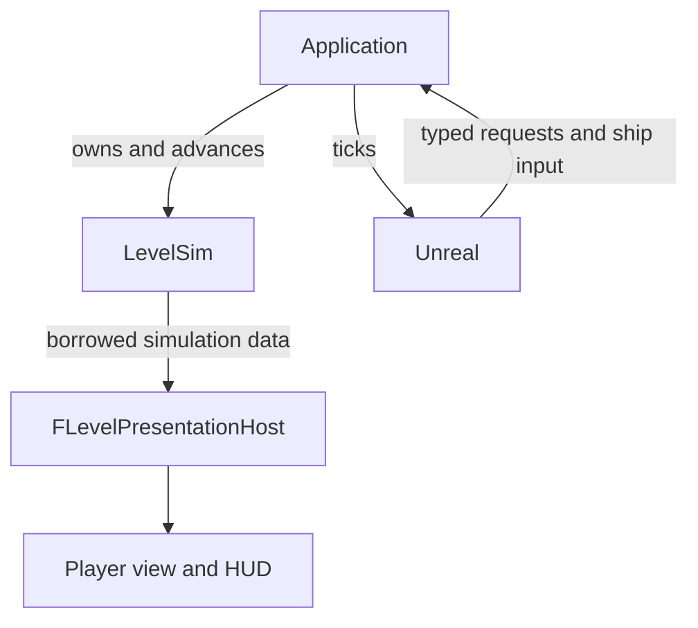

# SpaceGame runtime

Application owns the main loop, the current LevelSim and its reusable arena. Unreal creates presentation actors, supplies static geometry, and reads the bound simulation after fixed ticks. Application detaches presentation before destroying the level and resetting the arena. Menu actions and input travel back to Application in the published frame messages.

Carriers launch fighters in a vertical column above their collision bounds. Preview the column on the capital proxy.

[Author a level](../../LevelScripts/README.md) · [Simulation phases](../../native/simulation/ARCHITECTURE.md) · [Property categories](Categories.md)
