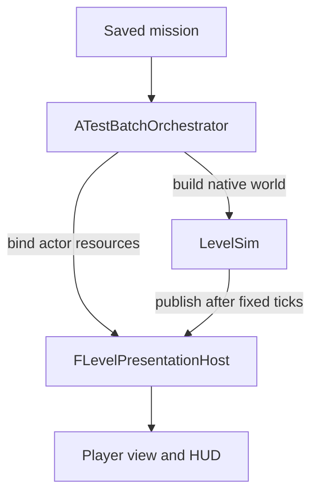

# SpaceGame runtime

Loading creates the player or observer, harvests static collision, and constructs a paused simulation. Automatic launches start it when requested. Presentation reads the final tick of each Unreal frame. Editor proxies supply placements through export.

Carriers launch fighters in a vertical column above their collision bounds. Preview the column on the capital proxy.

[Author a level](../../LevelScripts/README.md) · [Simulation phases](../../native/simulation/ARCHITECTURE.md) · [Property categories](Categories.md)
