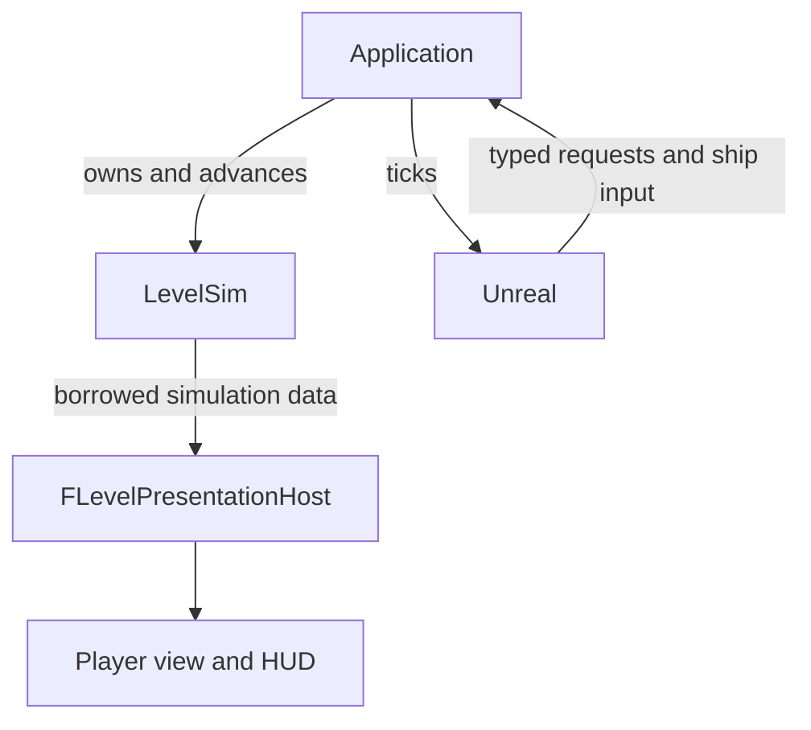

# SpaceGame runtime

Application owns the main loop, the current LevelSim and its reusable arena. It constructs the simulation paused using the mission's spawn data and static collision boxes. Once Unreal binds its presentation actors, Application starts the simulation if requested. Unreal reads the simulation after fixed ticks and publishes menu actions and input in frame messages. Application detaches presentation before destroying the level and resetting the arena.

Carriers launch fighters in a vertical column above their collision bounds. Preview the column on the capital proxy.

[Author a level](../../LevelScripts/README.md) · [Simulation phases](../../native/simulation/ARCHITECTURE.md) · [Property categories](Categories.md)
