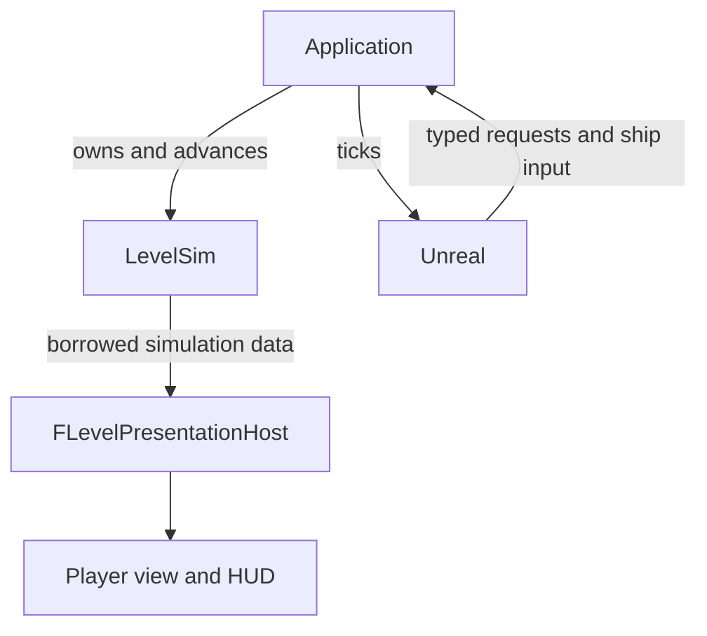

# SpaceGame runtime

Application owns the main loop. The native player constructs the simulation from the authored level and keeps only the resolved presentation inputs across world travel. When the world is ready, Unreal initializes its actors from those inputs and the first frame. The player then handles an initial terminal result or starts the simulation according to the requested mode. Frame columns are borrowed for each synchronous presentation call. On unload, the player publishes results, destroys the simulation, and rewinds its reusable arena.

Carriers launch fighters in a vertical column above their collision bounds. Preview the column on the capital proxy.

[Author a level](../../LevelScripts/README.md) · [Simulation phases](../../native/simulation/ARCHITECTURE.md) · [Property categories](Categories.md)
