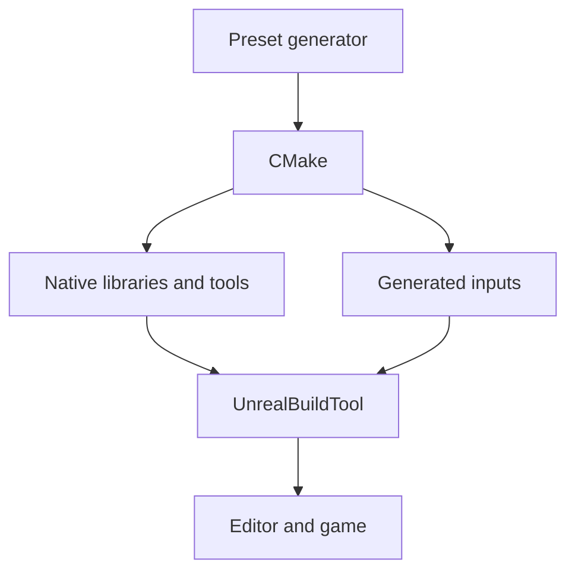

# Build ownership

Regenerate presets with `coj presets` and verify with `coj presets --check`. Edit Unreal modules in their `.Build.cs` files and targets in `.Target.cs` files. [Build and test](../docs/build-and-test.md) · [CMake style](STYLE.md)
