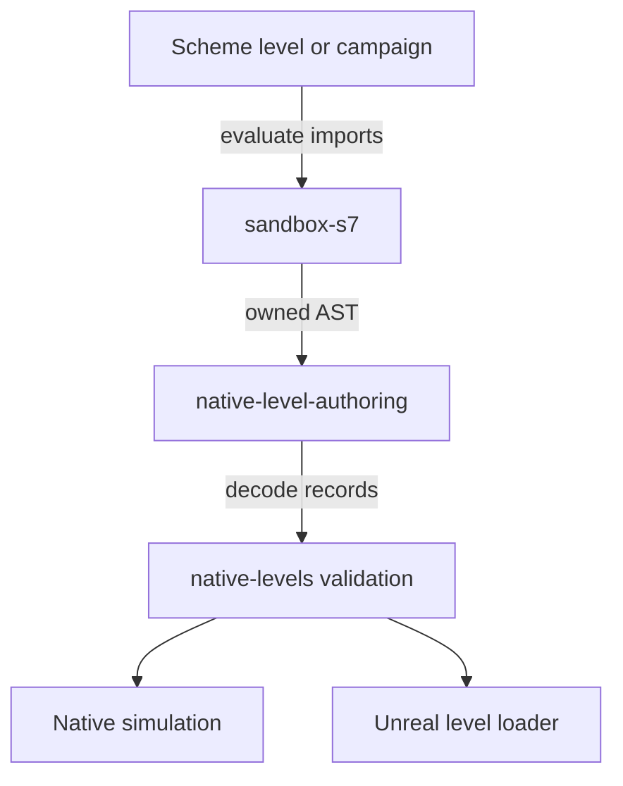

# Level loading

The catalog and each entry share one interpreter. Each gets its own nested-import budget and diagnostics, so a broken level leaves its siblings loadable. [Author a level](../../LevelScripts/README.md) · [Script-facing records](../../lispb/schema/level_inputs.lispb)
