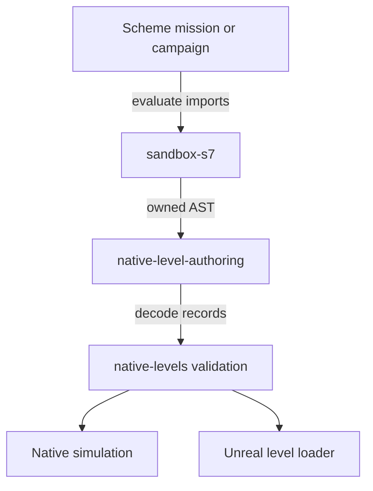

# Level loading

Catalog entries retain their own diagnostics, so a broken mission leaves its siblings loadable. [Author a mission](../../LevelScripts/README.md) · [Script-facing records](../../lispb/schema/level_inputs.lispb)
