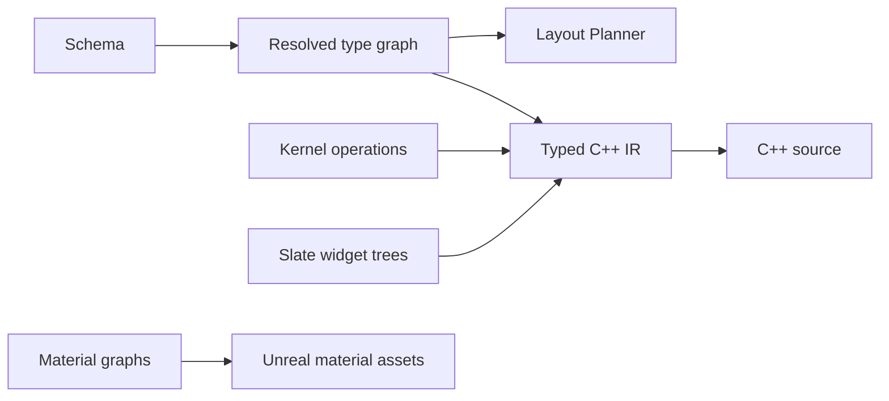

# Generate code and assets

Edit the inputs named in the [project manifest](../../lispb/project.lispb). From a prepared worktree, regenerate committed C++ and check for stale output:

```powershell
cmake --build --preset native --target generate-code
cmake --build --preset native --target check-generated-code
```



| Input | What to edit |
| --- | --- |
| Schema | Define a logical type. Add `(projections (cpp))` for an owning C++ type. [Entity IDs](../../lispb/schema/native_entity_id.lispb) · [External scalar registry](../../lispb/schema/types.lispb) |
| Kernel | Declare operation, operand storage, type sets, and aliasing in a [kernel module](../core/Kernels/vector_lerp.lispb). |
| Slate | Declare the static widget tree and slots. Keep dynamic state and event handling in the host. |
| Material | Edit the [source graph](../../Plugins/SandboxUI/Source/SandboxUI/Private/materials/UiGlowComposite.lispb). For UI glow, run `coj unreal generate-ui-glow-material`. See `coj unreal --help` for other assets. |

Include `<name>_view.h` to borrow column pointers and a shared row count. The columns may come from independent allocations. Include `<name>_compact_view.h` for allocation layouts and compact or strided views. Call `.resolve()` once before a hot loop. Include `<name>.h` to own and resize a table. Reacquire views after storage moves or borrowed rows are removed or reordered. Inspect physical layout with [Layout Planner](../../tools/layout_planner/README.md).

## S7 records and settings

```lisp
(record Weapon :generate-s7-reader true :s7-tag "weapon"
  (member damage float :initializer 5.f :nonnegative true)
  (member count int :required true)
  (projections (cpp)))
```

Reading `(:weapon :count 2)` keeps the default damage of 5. A fresh read requires `count`. `read_override` starts from an existing record. Required fields may be omitted in an override. Omitted fields retain their values, nested records merge, and collections replace the whole field. Unknown and duplicate names fail validation. Use `:s7-exclude true` for C++-only fields and `:generate-s7-writer true` for serialization. [Level inputs](../../lispb/schema/level_inputs.lispb) · [Settings](../../lispb/schema/settings.lispb)

## Enum helpers

Use `:helpers` for identifiers, serialized names, display labels, and formatting. String tables require unique dense values starting at zero. Mark enum members with groups to generate membership predicates and ordered value arrays. [Simulation enums](../../lispb/schema/native_simulation_enums.lispb)
